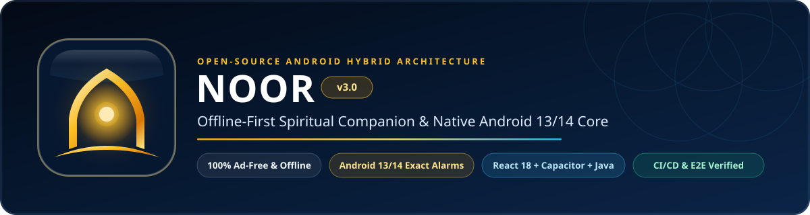
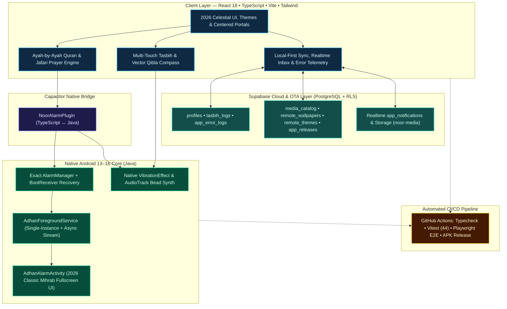

<div align="center">



<br />

<p>
  <a href="#-english-overview"><b>🇺🇸 English Overview</b></a>
  &nbsp;•&nbsp;
  <a href="#persian"><b>🇮🇷 همراه معنوی نور (نسخه کامل فارسی)</b></a>
  &nbsp;•&nbsp;
  <a href="https://github.com/yasin321/noor-app/releases/latest"><b>Download APK</b></a>
  &nbsp;•&nbsp;
  <a href="#system-architecture"><b>Architecture</b></a>
  &nbsp;•&nbsp;
  <a href="#roadmap"><b>Roadmap</b></a>
</p>

<p>
  <a href="https://github.com/yasin321/noor-app/releases/latest"></a>
  <a href="https://github.com/yasin321/noor-app/actions/workflows/browser-e2e.yml"></a>
  <a href="https://github.com/yasin321/noor-app/actions/workflows/build-apk.yml"></a>
  <a href="https://github.com/yasin321/noor-app/blob/main/LICENSE"></a>
  
  
  
  
  
  
  
</p>

</div>

---

## 🇺🇸 English Overview

Most hybrid mobile apps break down under modern Android OS restrictions—**Doze Mode**, **Android 13–16 exact-alarm limits**, **background audio termination**, and **post-reboot schedule loss**.

**Noor (همراه معنوی نور)** solves these challenges in production as a **100% ad-free, Local-First spiritual companion**, combining a polished React 18 / TypeScript interface with kernel-level native Android Java services and a **Supabase Cloud + OTA** ecosystem built for cross-platform sync.

### Core Capabilities

<table>
  <tr>
    <td width="50%" valign="top">
      <h4>Kernel-Level Android 13–16 Exact Alarms &amp; Classic Lockscreen UI</h4>
      Custom Java <code>NoorAlarmPlugin</code>, <code>AdhanForegroundService</code>, and <code>BootReceiver</code> built on <code>setAlarmClock</code> with single-instance audio locking, reboot recovery, and a bespoke <b>2026 Classic Mihrab</b> full-screen alarm UI with live animated equalizer and dynamic per-surah/per-prayer verses.
    </td>
    <td width="50%" valign="top">
      <h4>Ayah-by-Ayah Quran Recitation &amp; Native Surah Scheduler</h4>
      Curated Mushaf with verified Jafari prayer calculations, <b>ayah-by-ayah audio streaming</b> (with pitch-preserving <code>1x–3x</code> speed control, preloading, auto-page turning, and synced Persian translation), plus native lockscreen recitation scheduling.
    </td>
  </tr>
  <tr>
    <td width="50%" valign="top">
      <h4>Multi-Touch Tasbih &amp; Anti-Jitter Qibla Compass</h4>
      Real multi-finger Pointer Events Tasbih with <b>native Android haptics</b> (<code>VibrationEffect</code>), zero-KB synthesized wooden bead acoustics (<code>AudioTrack</code>), OLED Sanctuary mode, and a centered two-stage circular-vector Qibla compass.
    </td>
    <td width="50%" valign="top">
      <h4>Local-First Cloud Sync &amp; Phone Authentication</h4>
      Optional phone + password accounts backed by PostgreSQL with strict <b>Row Level Security (RLS)</b>, full snapshot backup/restore across reinstalls and devices (while keeping private Muhasaba reflections 100% local on-device).
    </td>
  </tr>
  <tr>
    <td width="50%" valign="top">
      <h4>Live OTA Content Catalog &amp; Remote App Updater</h4>
      Push new Adhans, Tawashih chants, shrine wallpapers, occasion themes, and APK release announcements from Supabase without inflating the APK—complete with one-tap offline caching and an in-app Global Sync Hub.
    </td>
    <td width="50%" valign="top">
      <h4>Realtime Inbox, Birthday Greetings &amp; Cloud Error Telemetry</h4>
      Live Supabase Realtime notification inbox with unread indicators and instant popups, Jalali birthday celebration cards, React <code>ErrorBoundary</code> crash protection, and deduplicated cloud error logging (<code>app_error_logs</code>).
    </td>
  </tr>
</table>

---

## System Architecture

Noor bridges a Local-First React/Vite application with native Android 13–16 Java services and a Supabase Cloud/OTA backend (see [ARCHITECTURE.md](ARCHITECTURE.md) and [docs/ADMIN_OTA_GUIDE.md](docs/ADMIN_OTA_GUIDE.md)):



---

## Quick Start

```bash
git clone https://github.com/yasin321/noor-app.git
cd noor-app
npm install

# Optional: enable Supabase Cloud Sync, OTA Catalog & Realtime Inbox
# Create .env.local with VITE_SUPABASE_URL and VITE_SUPABASE_ANON_KEY
# Apply supabase/schema.sql in your Supabase SQL Editor

npm run dev

# Strict TypeScript check & 44 Vitest unit tests
npm run typecheck
npm test

# Build production web bundle & sync native Android project
npm run build
npx cap copy android
```

See [ANDROID_BUILD.md](ANDROID_BUILD.md) for Android builds, [docs/ADMIN_OTA_GUIDE.md](docs/ADMIN_OTA_GUIDE.md) for OTA content publishing & media compression (`scripts/optimize-media.ps1`), and [Releases](https://github.com/yasin321/noor-app/releases) for pre-built APKs.

---

## Roadmap

- [x] Offline-first Jafari prayer engine & curated Mushaf with ayah-by-ayah audio + auto page-turn
- [x] Native Android 13–16 exact `AlarmManager`, `BootReceiver` recovery & 2026 Classic Mihrab lockscreen UI
- [x] Multi-touch Tasbih with native Android `VibrationEffect` & zero-KB `AudioTrack` bead audio
- [x] Two-stage anti-jitter Qibla compass & smart interactive Mosque Finder
- [x] Local-First Supabase cloud sync (phone auth, full restore, RLS), OTA media/wallpapers/themes & remote updater
- [x] Realtime notification inbox, Jalali birthday greetings & cloud error telemetry (`ErrorBoundary`)
- [x] Vitest suite (44 tests), Playwright E2E & automated GitHub Actions APK releases
- [ ] **Mood-based instant spiritual relief card** ("How is your heart today?" — 1 verse + 1 short dua + audio)
- [ ] **Shared Family Khatm & Group Dhikr circles** powered by Supabase Realtime
- [ ] **Respectful Streak Pause mode** for prayer trackers & persistent lockscreen countdown bar
- [ ] **Chrome Extension (Manifest V3) & iOS PWA** synced to the same Noor Cloud account
- [ ] Extract `NoorAlarmPlugin` into a standalone open-source Capacitor plugin

See [CONTRIBUTING.md](CONTRIBUTING.md), [SECURITY.md](SECURITY.md), [CHANGELOG.md](CHANGELOG.md), and [LICENSE](LICENSE).

---

<a id="persian"></a>

<div dir="rtl">

## 🇮🇷 همراه معنوی نور (نسخه کامل فارسی)

<p align="left"><a href="#-english-overview">⬆️ بازگشت به نسخه انگلیسی (Back to English)</a></p>

**همراه معنوی نور (Noor)** یک اپلیکیشن اندروید **۱۰۰٪ رایگان، بدون تبلیغات و آفلاین‌محور (Local-First)** است که رابط کاربری مدرن React 18 و TypeScript را از طریق پل بومی Capacitor + Java به هسته اندروید ۱۳ تا ۱۶ و زیرساخت ابری Supabase (همگام‌سازی دوطرفه، محتوای زنده OTA و صندوق پیام لحظه‌ای) متصل می‌کند.

### ✨ امکانات و قابلیت‌های کلیدی نسخه ۲۰۲۶

<table>
  <tr>
    <td width="50%" valign="top">
      <h4>موتور آلارم کرنل اندروید ۱۳–۱۶ و صفحه قفل کلاسیک</h4>
      پلاگین نیتیو <code>NoorAlarmPlugin</code> با پخش پایدار اذان، تواشیح و تلاوت سوره حتی در Doze Mode و پس از ریستارت گوشی، همراه با طراحی تمام‌صفحه محراب طلایی، اکولایزر زنده و آیه اختصاصی هر رویداد.
    </td>
    <td width="50%" valign="top">
      <h4>قرآن با صوت آیه‌به‌آیه و کوک تلاوت خودکار</h4>
      پخش آیه‌به‌آیه ۹ سوره برگزیده با پیش‌بارگذاری، سرعت دقیق <code>1x–3x</code> بدون تغییر زیر و بم صدا، ورق‌زدن خودکار مصحف، اسکرول هم‌زمان ترجمه و کوک یادآور نیتیو روی صفحه قفل.
    </td>
  </tr>
  <tr>
    <td width="50%" valign="top">
      <h4>ذکرشمار چندانگشتی و قبله‌نمای ضدلرزش</h4>
      شمارش واقعی با ۱ تا ۵ انگشت هم‌زمان، صدا و ویبره نیتیو اندروید، حالت خلوت تمام‌صفحه OLED و قبله‌نمای دو‌مرحله‌ای وسط صفحه با کالیبراسیون تعاملی.
    </td>
    <td width="50%" valign="top">
      <h4>همگام‌سازی ابری دوطرفه و ورود با شماره موبایل</h4>
      ذخیره و بازیابی کامل آمار ذکرها، علاقه‌مندی‌ها، تعقیبات، قضا، نشانک‌های قرآن و تنظیمات پس از حذف یا تعویض گوشی (با حفظ ۱۰۰٪ خصوصی ماندن یادداشت‌های محاسبه نفس روی گوشی کاربر).
    </td>
  </tr>
  <tr>
    <td width="50%" valign="top">
      <h4>مرکز سینک گلوبال و محتوای زنده (OTA)</h4>
      دریافت اذان‌ها، تواشیح‌ها، والپیپرهای حرم، تم‌های مناسبتی و اعلان نسخه جدید بدون سنگین شدن APK، با دانلود آفلاین تک‌لمسی و اسکریپت بهینه‌سازی مدیا.
    </td>
    <td width="50%" valign="top">
      <h4>صندوق پیام لحظه‌ای، تبریک تولد و ارورلاگ ابری</h4>
      دریافت فوری خبرها و اطلاعیه‌ها با زنگوله خوانده‌نشده و پاپ‌آپ زنده (Realtime)، تبریک خودکار روز تولد شمسی در پروفایل، سپر ضدکرش و ثبت خودکار خطاها در دیتابیس.
    </td>
  </tr>
</table>

### 🗺️ نقشه راه مراحل بعدی

- کارت هوشمند **«حال دلت چطوره؟»** (آیه + دعای کوتاه + صوت آرامش‌بخش متناسب با حال روحی)
- **حلقه ختم و ذکر خانوادگی** با لینک دعوت و شمارش زنده
- **حالت توقف محترمانه زنجیره نماز** و نوار شمارش معکوس دائمی روی قفل صفحه
- انتشار **افزونه گوگل کروم (Manifest V3)** و **نسخه وب آیفون (PWA)** همگام با همین حساب کاربری
- استخراج **NoorAlarmPlugin** به‌صورت یک پلاگین مستقل اوپن‌سورس

[Releases](https://github.com/yasin321/noor-app/releases) • [ARCHITECTURE.md](ARCHITECTURE.md) • [ANDROID_BUILD.md](ANDROID_BUILD.md) • [docs/ADMIN_OTA_GUIDE.md](docs/ADMIN_OTA_GUIDE.md) • [SECURITY.md](SECURITY.md) • [LICENSE](LICENSE)

<p align="center">طراحی، معماری و توسعه توسط <b>یاسین</b></p>

</div>
