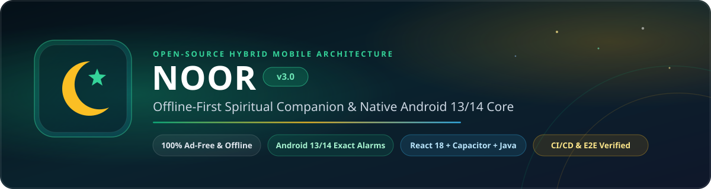
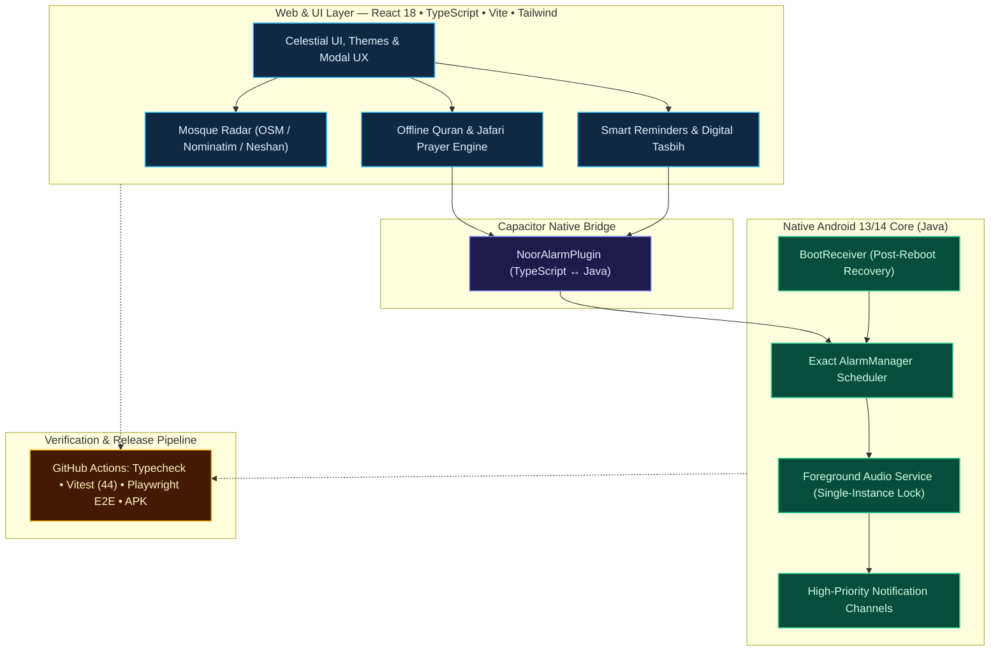

<div align="center">



<br />

<p>
  <a href="#-english-overview"><b>🇺🇸 English Overview</b></a>
  &nbsp;•&nbsp;
  <a href="#persian"><b>🇮🇷 همراه معنوی نور (نسخه کامل فارسی)</b></a>
  &nbsp;•&nbsp;
  <a href="https://github.com/yasin321/noor-app/releases/latest"><b>Download APK</b></a>
  &nbsp;•&nbsp;
  <a href="#-system-architecture"><b>Architecture</b></a>
  &nbsp;•&nbsp;
  <a href="#-roadmap"><b>Roadmap</b></a>
</p>

<p>
  <a href="https://github.com/yasin321/noor-app/releases/latest"></a>
  <a href="https://github.com/yasin321/noor-app/actions/workflows/browser-e2e.yml"></a>
  <a href="https://github.com/yasin321/noor-app/actions/workflows/build-apk.yml"></a>
  <a href="https://github.com/yasin321/noor-app/actions/workflows/ci.yml"></a>
  <a href="https://github.com/yasin321/noor-app/blob/main/LICENSE"></a>
</p>

<p>
  
  
  
  
  
  
  
  
</p>

</div>

---

## 🇺🇸 English Overview

Most hybrid mobile apps fail when pushed against strict modern Android OS policies—such as **Doze Mode**, **Android 13/14 exact-alarm restrictions**, **background audio termination**, and **post-reboot schedule loss**.

**Noor** solves these challenges in production as a **100% ad-free, offline-first spiritual companion**, while serving as a **lightweight, battle-tested open-source reference architecture** for bridging modern React/TypeScript UIs with kernel-level native Java Android services via Capacitor.

### Core Capabilities

<table>
  <tr>
    <td width="50%" valign="top">
      <h4>Offline-First Quran &amp; Prayer Engine</h4>
      Complete offline Quran catalog paired with a unit-tested astronomical prayer-time engine (Jafari reference verified across <code>jafariReference</code> &amp; <code>prayerTimes</code> suites)—zero mandatory cloud calls.
    </td>
    <td width="50%" valign="top">
      <h4>Kernel-Level Android 13/14 Exact Alarms</h4>
      Custom native Java <code>NoorAlarmPlugin</code> built on <code>AlarmManager</code> (<code>SCHEDULE_EXACT_ALARM</code>), with reboot-resilient <code>BootReceiver</code> rescheduling and OS permission flows.
    </td>
  </tr>
  <tr>
    <td width="50%" valign="top">
      <h4>Single-Instance Foreground Adhan Audio</h4>
      Dedicated Android Foreground Service featuring <b>single-instance audio locking</b> so Adhan playback remains uninterrupted and never overlaps—even when swiped away or in Doze Mode.
    </td>
    <td width="50%" valign="top">
      <h4>Multi-Engine Mosque Radar</h4>
      Token-free OpenStreetMap / Nominatim geolocation mode combined with Neshan Maps support, maintaining strict secret hygiene with zero exposed API keys in user settings.
    </td>
  </tr>
  <tr>
    <td width="50%" valign="top">
      <h4>Celestial UI &amp; Daily Tools</h4>
      Figma-redesigned Celestial Horizon banner, customizable glassmorphic themes, focused modal UX, unified startup splash screen, recurring reminders, and digital Tasbih.
    </td>
    <td width="50%" valign="top">
      <h4>Full-Stack QA &amp; Automated CI/CD</h4>
      Strict TypeScript checks, <b>44 Vitest unit tests</b> across 6 suites, <b>Playwright browser E2E tests</b>, Docker support, and automated GitHub Actions APK releases.
    </td>
  </tr>
</table>

---

## System Architecture

Noor connects a Vite/React frontend to native Android system services through a dedicated Capacitor Java bridge (see [ARCHITECTURE.md](ARCHITECTURE.md)):



---

## Quick Start

```bash
git clone https://github.com/yasin321/noor-app.git
cd noor-app
npm install
npm run dev

# Typecheck & 44 unit tests
npm run typecheck
npm test

# Build web assets & sync native Android
npm run build
npx cap sync android
```

See [ANDROID_BUILD.md](ANDROID_BUILD.md) for Gradle/APK signing and [Releases](https://github.com/yasin321/noor-app/releases) for pre-built APKs.

---

## Roadmap

- [x] Offline-first Quran catalog & verified Jafari prayer calculation engine
- [x] Native Android 13/14 exact `AlarmManager` + `BootReceiver` persistence
- [x] Foreground Audio Service with single-instance lock for uninterrupted Adhan
- [x] Token-free OpenStreetMap / Nominatim mosque radar + Neshan support
- [x] Vitest suite (44 tests), Playwright E2E, and automated APK CI/CD
- [ ] **Extract `NoorAlarmPlugin` into a standalone open-source Capacitor plugin** (`capacitor-android-exact-alarm`)
- [ ] Automated CI APK bundle-size budgets & Android API regression checks
- [ ] Instrumented Android Doze-Mode reliability tests & multilingual UI (EN / FA / AR)

See [CONTRIBUTING.md](CONTRIBUTING.md), [SECURITY.md](SECURITY.md), [CHANGELOG.md](CHANGELOG.md), and [LICENSE](LICENSE).

---

<a id="persian"></a>

<div dir="rtl">

## 🇮🇷 همراه معنوی نور (نسخه کامل فارسی)

<p align="left"><a href="#-english-overview">⬆️ بازگشت به نسخه انگلیسی (Back to English)</a></p>

نور (Noor) یک اپلیکیشن اندروید ۱۰۰٪ رایگان، بدون تبلیغات، متنـباز و آفلاین‌محور (Offline-First) است که رابط کاربری مدرن React 18 و TypeScript را از طریق پل بومی Capacitor + Java مستقیماً به هسته اندروید ۱۳ و ۱۴ متصل می‌کند.

### ✨ امکانات و قابلیتهای کلیدی

<table>
  <tr>
    <td width="50%" valign="top">
      <h4>قرآن کامل آفلاین و موتور اوقات شرعی</h4>
      کاتالوگ کامل قرآن بدون نیاز به اینترنت همراه با موتور محاسبات اوقات شرعی جعفری تاییدشده با تست واحد.
    </td>
    <td width="50%" valign="top">
      <h4>موتور آلارم دقیق اندروید ۱۳ و ۱۴</h4>
      پلاگین اختصاصی جاوا NoorAlarmPlugin با AlarmManager و BootReceiver برای بازیابی خودکار زمانبندی پس از ریبوت.
    </td>
  </tr>
  <tr>
    <td width="50%" valign="top">
      <h4>پخش پایدار اذان با قفل صوتی تک‌نمونه</h4>
      سرویس Foreground اختصاصی با قفل صوتی برای پخش بی‌وقفه و بدون تداخل اذان حتی در پس‌زمینه و Doze Mode.
    </td>
    <td width="50%" valign="top">
      <h4>رادار مساجد چندموتوره (OSM و نشان)</h4>
      مسجدیاب بدون نیاز به توکن با OpenStreetMap / Nominatim همراه با پشتیبانی از نقشه نشان و حفظ امنیت کلیدهای API.
    </td>
  </tr>
  <tr>
    <td width="50%" valign="top">
      <h4>رابط کاربری لوکس و ابزارهای روزانه</h4>
      بنر افق آسمانی، تم‌های شیشه‌ای قابل شخصی‌سازی، منوهای مودال، اسپلش یکپارچه، تسبیح دیجیتال و یادآورهای تکرارشونده.
    </td>
    <td width="50%" valign="top">
      <h4>تست‌های جامع و بیلد خودکار CI/CD</h4>
      ۴۴ تست واحد Vitest، تستهای مرورگر Playwright E2E و انتشار خودکار APK در GitHub Actions.
    </td>
  </tr>
</table>

### نقشه راه آینده (Roadmap)

* استخراج **NoorAlarmPlugin** به صورت یک پلاگین مستقل و اوپن‌سورس Capacitor برای جامعه برنامه‌نویسان
* کنترل خودکار حجم APK در CI و تست‌های پایداری در Doze Mode
* پشتیبانی چندزبانه کامل (فارسی، انگلیسی و عربی)

[Releases](https://github.com/yasin321/noor-app/releases) • [ARCHITECTURE.md](ARCHITECTURE.md) • [ANDROID_BUILD.md](ANDROID_BUILD.md) • [SECURITY.md](SECURITY.md) • [LICENSE](LICENSE)

</div>
