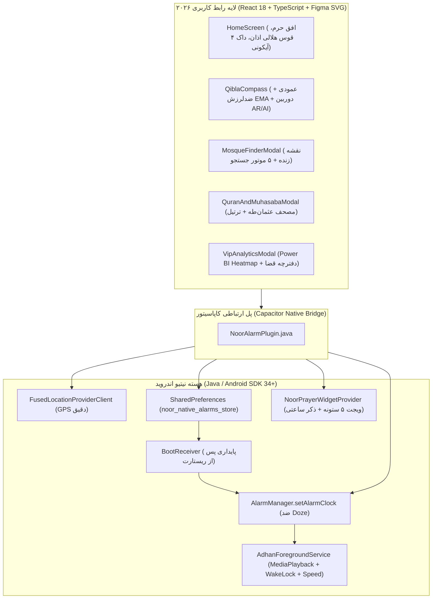

# <div align="center">🕌 همراه معنوی نور (Noor Spiritual Companion)</div>

<h3 align="center">✨ اللَّهُمَّ بَارِكْ لِمَوْلَانَا صَاحِبِ الزَّمَانِ (عج) ✨</h3>

<div align="center">

[](https://github.com/yasin321/noor-app/actions/workflows/build-apk.yml)
[](https://github.com/yasin321/noor-app/actions/workflows/ci.yml)
[](https://github.com/yasin321/noor-app/releases/latest)


**سوپراپلیکیشن مدرن و مهندسی‌شده اوقات شرعی، اذان‌گوی نیتیو اندروید، مصحف عثمان‌طه، قبله‌نمای عمودی هوش مصنوعی (AR/AI)، رادار مسجدیاب ۵ موتوره و داشبورد تحلیلی Power BI**

[📲 **دانلود آخرین نسخه اندروید (APK) از بخش Releases**](https://github.com/yasin321/noor-app/releases/latest) · [🏛️ **معماری فنی (Architecture)**](./ARCHITECTURE.md) · [📋 **تاریخچه نسخه‌ها (Changelog)**](./CHANGELOG.md) · [🛡️ **امنیت و حریم خصوصی**](./SECURITY.md)

</div>

---

## 🪪 شناسنامه رسمی پروژه (Product Identity Card)

| ویژگی / مشخصه | جزئیات فنی و اجرایی |
| :--- | :--- |
| **نام محصول** | **همراه معنوی نور (Noor Spiritual Companion)** |
| **خالق، طراح محصول و معمار نرم‌افزار** | **یاسین (Yasin)** — [@yasin321](https://github.com/yasin321) |
| **نسخه فعلی (Production Release)** | `v3.0.x` (نسخه‌بندی خودکار CI/CD منطبق با هر کامیت در شاخه `main`) |
| **پلتفرم‌های هدف** | **Android 8.0 تا Android 15 (API 26–35)** + نسخه وب پیش‌رونده (**PWA**) |
| **پشته فناوری فرانت‌اند** | React 18 · TypeScript (Strict Mode) · Vite · Tailwind CSS · Custom SVG Vector Engine |
| **پشته فناوری نیتیو اندروید** | Java · Capacitor Custom Bridge · `AlarmManager.setAlarmClock` · `FusedLocationProviderClient` · `ForegroundService (mediaPlayback)` |
| **موتورهای نقشه و مکان‌یابی** | ۵ موتور موازی: **Neshan Maps API** + **OSM Nominatim** + **Overpass Radar** + **Google Places** + **Offline Android Geocoder** |
| **پوشش تست و تضمین کیفیت** | بررسی سخت‌گیرانه تایپ‌اسکریپت (`tsc --noEmit`) + تست‌های واحد **Vitest** + تست‌های مرورگر **Playwright E2E** |
| **مجوز انتشار (License)** | **MIT Open-Source License** |

---

## ✨ تمایزهای کلیدی نسخه ۳.۰ (2026 Figma Redesign & Native Core)

### ۱. 🎨 طراحی رابط کاربری ۲۰۲۶ (Figma Luxury UI)
- **افق تصویری پویا (`DynamicShrineHorizonArt`):** تصویرسازی برداری گنبد طلایی، گلدسته‌ها و افق آسمان که بر اساس شهر انتخابی (مشهد، قم، شیراز، تهران...) و وقت شرعی فعلی تغییر می‌کند.
- **قوس هلالی بزرگ اذان (`CelestialPrayerArcGauge`):** نمایش مسیر رسیدن به اذان بعدی روی مدار هلالی نیم‌دایره با گوی نورانی متحرک.
- **۱۲ پوسته چشمنواز (۶ پوسته مناسبتی طرح‌دار + ۶ پوسته کلاسیک):** شامل ضیافت رمضان 🌙، شب یلدا 🍉، عید نوروز 🌱، ماه محرم 🏴، ایام فاطمیه 🕯️ و شکوفه بهاری 🌸.

### ۲. 🧭 قبله‌نمای عمودی بدون لرزش + واقعیت افزوده (AI / AR Mode)
- **عملکرد در حالت عمودی (Upright Portrait):** جبران مثلثاتی محور دید پشت گوشی بدون نیاز به قرار دادن افقی گوشی روی زمین.
- **فیلتر ضدلرزش (`Circular EMA Filter`):** میانگین‌گیری برداری روی $\sin(\theta)$ و $\cos(\theta)$ برای حذف کامل پرش عقربه.
- **نمای هوشمند دوربین (AR Kaaba Lock):** نمایش کعبه سه‌بعدی، فاصله دقیق تا مکه مکرمه، ویبره لمسی در لحظه هم‌راستایی و راهنمای کالیبراسیون شکل $\infty$.

### ۳. 🔔 استودیو اعلان قبل از اذان، خود اذان و سوره کامل پس از نماز
- **پشتیبانی از سرعت پخش (`0.85x` تا `2.0x`):** تنظیم سرعت قرائت از طریق `PlaybackParams` در هسته اندروید.
- **گنجینه صوتی منتخب:** نوای ناد علی (ع)، تواشیح اسماء الحسنی، فرازهای طلایی عبدالباسط و منشاوی، اذان‌های ماندگار ایران (مؤذن‌زاده، آقاتی، ذبیحی، صبحدل، منصوری) و پخش کامل سوره‌های مجرب پس از اذان.

### ۴. 📊 داشبورد تحلیلی Power BI و جعبه ابزار VIP
- **۴ کارت KPI کلیدی:** زنجیره فعلی (`Current Streak`)، بهترین رکورد (`Best Streak`)، نرخ استمرار ۳۰ روزه (`Consistency %`) و مقایسه هفتگی (`▲ 81%`).
- **ماتریس حرارتی ۵۲ هفته‌ای (`Activity History Heatmap`)** با ۳ تم نئونی (بنفش، نارنجی، زمردی) + نمودار موجی تحقق ماهانه.
- **دفترچه هوشمند نماز و روزه قضا** + **تایمر ۱۵ دقیقه‌ای خلوت خشوع**.

---

## 🏗️ دیاگرام معماری سیستم (System Architecture)



---

## 🚀 دستورات نصب، تست و بیلد (Quick Start)

```bash
# ۱. نصب پکیج‌ها
npm install

# ۲. بررسی تایپ‌های TypeScript و اجرای تست‌ها
npm run typecheck
npm test

# ۳. بیلد نهایی و همگام‌سازی با پروژه اندروید
npm run build
npx cap sync android
```

---

<div align="center">
  طراحی، معماری و توسعه توسط <strong>یاسین (Yasin)</strong> · منتشرشده تحت مجوز MIT
</div>
