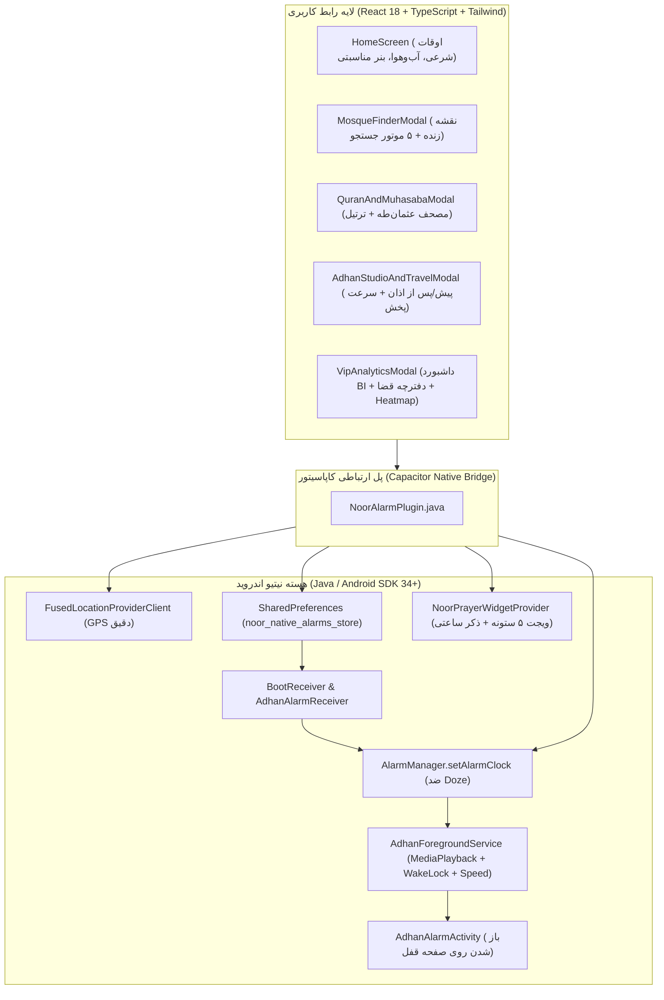

# <div align="center">🕌 همراه معنوی نور (Noor Spiritual Companion)</div>

<div align="center">

[](https://github.com/yasin321/noor-app/actions/workflows/build-apk.yml)
[](https://github.com/yasin321/noor-app/actions/workflows/ci.yml)
[](https://github.com/yasin321/noor-app/actions/workflows/e2e.yml)


**یک سوپراپلیکیشن مدرن، اصیل و مهندسی‌شده برای مدیریت هوشمند اوقات شرعی، اذان‌گوی تمام‌صفحه نیتیو، مصحف آفلاین عثمان‌طه، رادار مسجدیاب ۵ موتوره و داشبورد تحلیلی معنوی (BI)**

[📲 **دانلود آخرین نسخه اندروید (APK) از بخش Releases**](https://github.com/yasin321/noor-app/releases/latest) · [📖 **مستندات معماری (Architecture)**](./ARCHITECTURE.md) · [🐞 **گزارش باگ**](https://github.com/yasin321/noor-app/issues)

</div>

---

## ✨ ویژگی‌های برجسته و تمایزهای مهندسی (Key Highlights)

### ۱. 🔔 موتور آلارم و اذان‌گوی سطح کرنل اندروید (`AlarmManager.setAlarmClock`)
- **بیدارباش تضمینی در حالت Doze Mode و صفحه قفل:** استفاده از `setAlarmClock` در لایه جاوا (`NoorAlarmPlugin.java`) و سرویس پیش‌زمینه `mediaPlayback` سازگار با **Android 14/15**.
- **پایداری ۱۰۰٪ پس از ریستارت گوشی (Reboot Survival):** ذخیره‌سازی مشخصات کامل آلارم‌ها در `SharedPreferences` نیتیو و بازگردانی خودکار توسط `BootReceiver` و `AdhanAlarmReceiver` به محض روشن شدن گوشی (حتی بدون باز کردن اپلیکیشن).
- **سه لایه اعلان مجزا با کنترل سرعت پخش (`0.85x` تا `2.0x`):**
  1. **پیش از اذان:** نواهای ملکوتی (ناد علی ع، اسماء الحسنی، مناجات ربنا و فرازهای طلایی استاد عبدالباسط و منشاوی).
  2. **خود اذان:** گنجینه اذان‌های ماندگار ایران و جهان (استاد رحیم و سلیم مؤذن‌زاده اردبیلی، استاد آقاتی حرم رضوی، سید جواد ذبیحی، صبحدل، منصوری، غلوش).
  3. **پس از اذان:** تسبیحات حضرت زهرا (س)، آیةالکرسی، دعای فرج و **تلاوت کامل سوره‌های منتخب** با صدای استاد پرهیزگار.

### ۲. 🧭 رادار مسجدیاب ۵ موتوره و نقشه زنده تعاملی
- **مکان‌یابی نقطه‌ای داخل ساختمان (`Google Play Services FusedLocationProviderClient`):** ترکیب سیگنال GPS، وای‌فای و سنسورهای حرکتی با دقت زیر ۱۰ متر و حذف خطای دکل‌های مخابراتی.
- **جستجوی موازی ۵ کاناله:** ترکیب هم‌زمان **API رسمی نشان (`v5/reverse` & `v1/search`)**، **OpenStreetMap Nominatim Viewbox**، **Overpass Mosque Radar**، **Google Maps Places** و **Geocoder آفلاین اندروید**.
- **نقشه زنده (Interactive Street Map):** نمایش دایره آبی تپنده کاربر و پین‌های مساجد اطراف با قابلیت جابه‌جایی دستی پین روی نقشه و مسیریابی مستقیم.

### ۳. 📖 مصحف آفلاین عثمان‌طه و سیستم صوتی هوشمند
- باندل کامل متن و ترجمه سوره‌های مجرب با رسم‌الخط استاندارد عثمان‌طه و حذف هوشمند بسم‌الله تکراری.
- پخش پیوسته آیه‌به‌آیه با اسکرول خودکار و ورق زدن اتوماتیک صفحات مصحف.

### ۴. 🌤️ هواشناسی زنده، تقویم سه‌گانه نجومی و ۱۲ پوسته مناسبتی
- **ویجت آب‌وهوای فیگما (Figma-Grade Weather Pill):** نمایش دمای لحظه‌ای، وضعیت آسمان، کمینه/بیشینه و پیش‌بینی ۷ روزه در تقویم (با پشتیبانی از `°C` و `°F`).
- **تقویم شمسی، قمری و میلادی:** همراه با محاسبه دقیق نجومی **قمر در عقرب** و مناسبت‌های ملی و مذهبی.
- **۱۲ پوسته چشمنواز (۶ پوسته مناسبتی طرح‌دار + ۶ پوسته کلاسیک):** شامل ضیافت رمضان 🌙، شب یلدا 🍉، عید نوروز 🌱، ماه محرم 🏴، ایام فاطمیه 🕯️ و شکوفه بهاری 🌸.

### ۵. 📊 جعبه ابزار VIP، داشبورد BI و ویجت صفحه اصلی اندروید
- **ابزارهای VIP:** پیگیری نماز اول وقت، دفترچه شمارش معکوس نماز و روزه قضا، سپر خلوت و سم‌زدایی دیجیتال (Khushu Focus) و حلقه ختم خانوادگی.
- **داشبورد BI:** نمودار میله‌ای تحقق برنامه‌های هفتگی (`Planned vs. Actual`) و **نقشه حرارتی ۳۵ روزه به سبک گیت‌هاب (GitHub Heatmap)**.
- **ویجت نیتیو ۵ ستونه اندروید (`NoorPrayerWidgetProvider`):** نمایش ۵ وقت شرعی به همراه **ذکر پویا** بر اساس روز هفته و ساعت شبانه‌روز.

---

## 🏗️ دیاگرام معماری سیستم (System Architecture)



---

## 🚀 راه‌اندازی و توسعه (Quick Start & Build)

```bash
# ۱. نصب وابستگی‌ها
npm install

# ۲. بررسی تایپ‌های TypeScript (بدون خطا)
npm run typecheck

# ۳. اجرای تست‌های واحد و یکپارچگی (Vitest)
npm test

# ۴. اجرای محیط توسعه وب
npm run dev

# ۵. ساخت باندل نهایی و همگام‌سازی با اندروید
npm run build
npx cap sync android
```

---

## 📁 ساختار پوشه‌های پروژه (Project Structure)

```text
noor-app/
├── android/app/src/main/java/com/noor/app/
│   ├── MainActivity.java              # اکتیویتی اصلی و تنظیمات شتاب‌دهنده سخت‌افزاری WebView
│   ├── NoorAlarmPlugin.java           # پلاگین نیتیو آلارم، مکان‌یاب Fused، ویجت و مدیریت صوت
│   ├── AdhanAlarmReceiver.java        # گیرنده سیگنال آلارم و بازیابی خودکار پس از ریستارت
│   ├── BootReceiver.java              # تضمین کوک مجدد آلارم‌ها در رویداد BOOT_COMPLETED
│   ├── AdhanForegroundService.java    # سرویس پخش صوت با WakeLock و تنظیم سرعت (PlaybackParams)
│   ├── AdhanAlarmActivity.java        # رابط تمام‌صفحه بیدارکننده صفحه قفل گوشی
│   └── NoorPrayerWidgetProvider.java  # ویجت ۵ ستونه اندروید با موتور ذکر هوشمند ساعتی/روزانه
├── src/
│   ├── components/                    # کامپوننت‌های رابط کاربری و مودال‌های تخصصی
│   ├── hooks/                         # هوک‌های مدیریت تم و احراز هویت
│   ├── lib/                           # منطق تجاری، محاسبات نجومی، سرویس‌های نقشه و هواشناسی
│   └── App.tsx                        # هسته مسیریابی، ژست‌های لمسی و مدیریت چرخه حیات
└── .github/workflows/                 # پایپ‌لاین‌های CI/CD، تست شبیه‌ساز و انتشار خودکار APK
```

---

<div align="center">
  ساخته‌شده با ❤️ و دقت مهندسی برای تجربه‌ای آرامش‌بخش و معنوی
</div>
