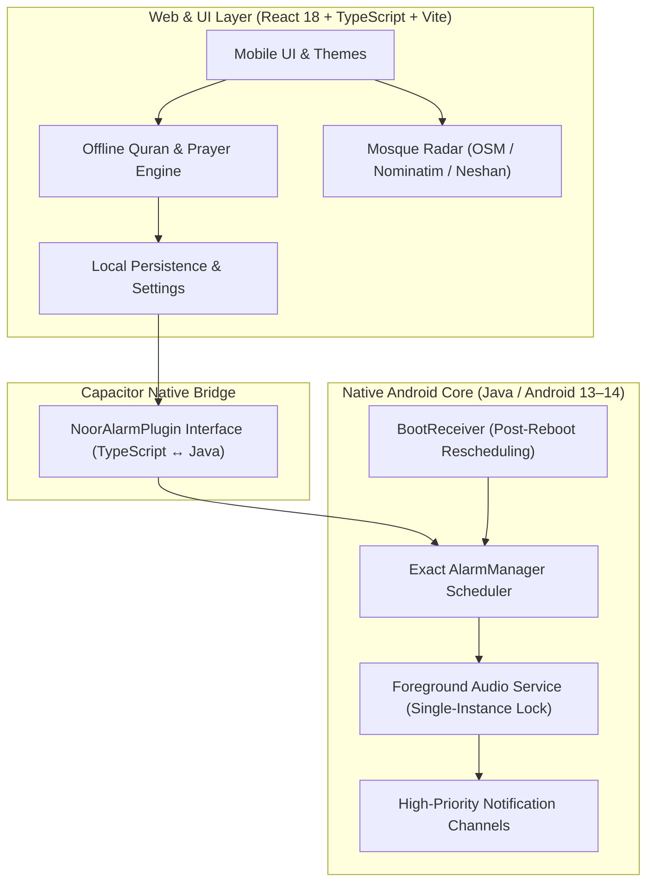

<div align="center">

# 🕌 Noor — Offline-First Spiritual Companion & Native Android Hybrid Core

**Lightweight, privacy-first, open-source Android application built with React 18, TypeScript, Capacitor, and native Java system services.**

[🇺🇸 English](README.md) • [🇮🇷 فارسی (Persian)](README.fa.md)

<p>
  <a href="https://github.com/yasin321/noor-app/releases/latest">
    
  </a>
  <a href="https://github.com/yasin321/noor-app/actions/workflows/build-apk.yml">
    
  </a>
  <a href="https://github.com/yasin321/noor-app/blob/main/LICENSE">
    
  </a>
  
  
  
</p>

[Download Latest APK](https://github.com/yasin321/noor-app/releases/latest) • [Architecture](ARCHITECTURE.md) • [Android Build Guide](ANDROID_BUILD.md) • [Roadmap](#-roadmap) • [Changelog](CHANGELOG.md)

</div>

---

## 🎯 Why Noor?

Most hybrid mobile apps break down under modern Android OS constraints—such as Doze Mode, Android 13/14 exact-alarm restrictions, background audio termination, and reboot persistence.

**Noor** solves these challenges in production as a **100% ad-free, offline-first spiritual companion** while serving as a **production-tested open-source reference architecture** for building reliable web-to-native Android bridges with Capacitor and custom Java plugins.

### Key Highlights

| Area | Implementation |
| :--- | :--- |
| **Offline-First Core** | Complete offline Quran catalog, local prayer-time calculation engine, and zero mandatory cloud dependency. |
| **Native Exact-Alarm Engine** | Custom Java `NoorAlarmPlugin` utilizing Android `AlarmManager` (`SCHEDULE_EXACT_ALARM`), reboot-resilient `BootReceiver`, and Android 13/14 permission flows. |
| **Reliable Background Audio** | Dedicated Android Foreground Service with **single-instance audio locking** to guarantee uninterrupted, non-overlapping Adhan playback even when the app is killed. |
| **Multi-Engine Mosque Radar** | Token-free OpenStreetMap / Nominatim fallback mode combined with Neshan Maps geolocation support—zero exposed API secrets in client UI. |
| **Lightweight & Tested** | Clean modal-driven mobile ergonomics, unified startup splash screen, Vitest + Playwright E2E coverage, and strictly monitored APK bundle sizes. |
| **Automated CI/CD Pipeline** | End-to-end GitHub Actions workflows for TypeScript type-checking, unit/E2E testing, automated versioning, and reproducible APK releases. |

---

## 🏗️ System Architecture

Noor bridges a modern React/TypeScript frontend with kernel-level Android scheduling and audio services via a custom native Capacitor plugin layer (see [ARCHITECTURE.md](ARCHITECTURE.md) for deeper technical details):



---

## 🚀 Quick Start

### Prerequisites
- **Node.js** `>= 18.x` & `npm`
- **Java JDK** `17` (for Android Gradle builds)
- **Android SDK** (API Level 33/34)

### Local Development

```bash
git clone https://github.com/yasin321/noor-app.git
cd noor-app
npm install
npm run dev
```

### Testing & Type-Checking

```bash
npm run typecheck
npm test
```

### Build & Sync Android APK

```bash
npm run build
npx cap sync android
cd android
./gradlew assembleDebug
```

For full Android build and signing details, see [ANDROID_BUILD.md](ANDROID_BUILD.md). Pre-built APKs are automatically published in [Releases](https://github.com/yasin321/noor-app/releases).

---

## 🗺️ Roadmap

Our goal is to keep Noor ultra-lightweight while contributing reusable native primitives back to the broader Capacitor and Android open-source ecosystem:

- [x] Offline-first prayer calculation & full Quran catalog
- [x] Android 13/14 exact `AlarmManager` + `BootReceiver` persistence
- [x] Foreground Service with single-instance audio lock
- [x] Token-free OpenStreetMap / Nominatim mosque radar
- [x] Automated GitHub Actions CI/CD APK release pipeline
- [ ] **Extract `NoorAlarmPlugin` into a standalone open-source Capacitor plugin** (`capacitor-android-exact-alarm`) for the community
- [ ] Automated CI bundle-size budgets & Android API regression checks
- [ ] Expanded unit, Playwright E2E, and instrumented Android tests for Doze Mode edge cases
- [ ] Multilingual localization (English, Arabic, Persian)

---

## 🤝 Contributing & Security

- **Contributing:** See [CONTRIBUTING.md](CONTRIBUTING.md) for guidelines and PR workflow.
- **Security:** Please review [SECURITY.md](SECURITY.md) before reporting any vulnerabilities.
- **Changelog:** Track releases and fixes in [CHANGELOG.md](CHANGELOG.md).
- **License:** Distributed under the project [LICENSE](LICENSE).
